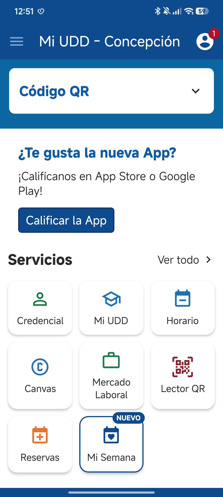
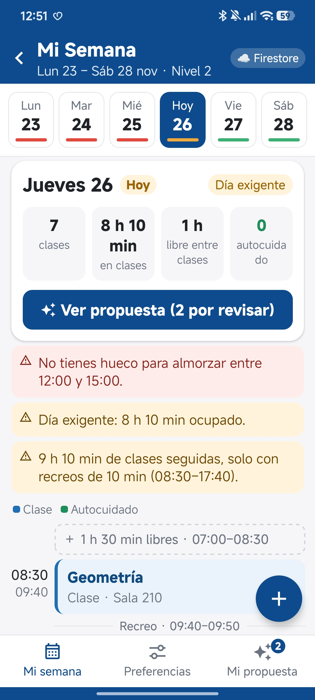
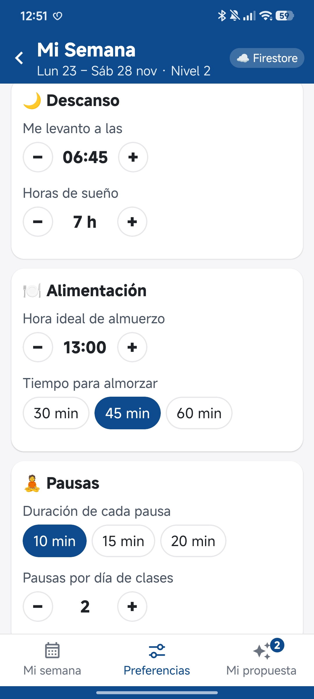
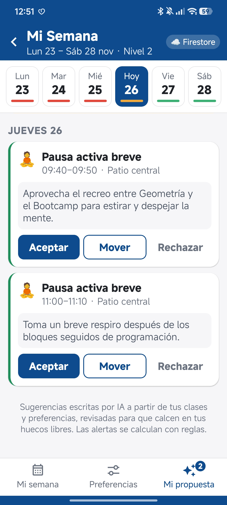

<div align="center">

# 📅 Calendario UDD | Mi Semana

**Un módulo de bienestar estudiantil para _Mi UDD_ que lee tu horario, detecta los días sobrecargados y te propone pausas, comidas y descanso en tus huecos libres reales.**

[](#-reconocimiento-y-autor)
[](#-reconocimiento-y-autor)


📄 [Informe del proyecto (PDF)](docs/Informe_CalendarioUDD.pdf)

</div>

---

## 🎯 El problema y la solución

### El problema

Una jornada en la UDD puede tener hasta **8 módulos de 1 h 10 min** separados por recreos de 10 minutos, que apenas alcanzan para cambiar de sala. El horario de _Mi UDD_ informa qué clase viene, pero no muestra cuánto pesa el día ni dónde quedan los tiempos libres. En semanas de certámenes el almuerzo se reduce a lo que sobre entre dos clases, la pausa no ocurre y el sueño cede frente al estudio.

En una encuesta propia a **40 estudiantes UDD**:

- El **50 %** calificó su estrés académico en 4 o 5 (escala de 1 a 5).
- Lo primero que sacrifican es **dormir 7-8 horas** (36,8 %), seguido de las pausas (26,3 %), la alimentación (21,1 %) y la actividad física (15,8 %).
- La principal barrera no es la falta de interés, sino el **agotamiento mental** (42,1 %).

Agendas de papel, Google Calendar o Notion se abandonan justo en las semanas críticas, porque mantenerlos al día exige más energía. Las herramientas de productividad con IA imponen bloques y le quitan el control al estudiante.

### La solución

**Mi Semana** es un módulo integrado en el ecosistema _Mi UDD_ que funciona como un acompañante, no como un jefe:

- **Cero fricción:** las clases ya vienen cargadas desde el horario; el estudiante no transcribe nada.
- **Visibilidad de la carga:** cada día muestra su peso real y alerta cuando falta tiempo para comer o descansar.
- **Sugerencias, no imposiciones:** la IA propone autocuidado en los huecos libres y el estudiante decide si acepta, mueve o rechaza cada sugerencia.
- **Privacidad por diseño:** solo se guardan clases y autocuidado, nunca actividades personales, con acceso anónimo.

---

## ✨ Funcionalidades principales

| | Funcionalidad | Detalle |
|---|---|---|
| 🏠 | **Integración en _Mi UDD - Concepción_** | El módulo aparece como un servicio más en el Inicio de la app, junto a Credencial, Horario y Canvas. |
| 🚦 | **Semáforo de carga académica** | Cada día muestra un nivel de carga (por ejemplo, `Día exigente`), las clases, las horas en clase, el tiempo libre entre clases y los bloques de autocuidado. Una barra de color indica qué días ya pasaron, cuál es hoy y cuáles faltan. |
| ⚠️ | **Alertas automáticas por reglas** | Detecta días sin hueco para almorzar entre 12:00 y 15:00, bloques de más de 4 h seguidos solo con recreos, cruces de horario, días sobrecargados y días que terminan muy tarde. |
| ⚙️ | **Autocuidado personalizable** | **Descanso** (hora de levantarse y horas de sueño), **Alimentación** (hora ideal y tiempo de almuerzo) y **Pausas** (duración y cantidad por día de clases), además de un orden de prioridades. |
| ✨ | **Mi propuesta con IA** | Gemini propone autocuidado para el día elegido, explicando el motivo de cada sugerencia. Cada una se puede **Aceptar**, **Mover** o **Rechazar**, y todo tiene **Deshacer**. El código valida que cada sugerencia calce en un hueco libre real. |
| ☁️ | **Sincronización con Firestore** | La semana de cada participante se guarda en la nube y queda una copia en el teléfono para funcionar sin señal. |

---

## 📱 Capturas de la aplicación

<table align="center">
  <tr>
    <td align="center"></td>
    <td align="center"></td>
    <td align="center"></td>
    <td align="center"></td>
  </tr>
  <tr>
    <td align="center"><b>Inicio Mi UDD</b><br><sub>Acceso al nuevo módulo</sub></td>
    <td align="center"><b>Mi semana</b><br><sub>Carga del día y alertas</sub></td>
    <td align="center"><b>Preferencias</b><br><sub>Descanso, alimentación y pausas</sub></td>
    <td align="center"><b>Mi propuesta</b><br><sub>Sugerencias con IA</sub></td>
  </tr>
</table>

---

## 🛠️ Stack tecnológico y arquitectura

| Capa | Tecnología | Función |
|---|---|---|
| App móvil | React Native 0.88 · Expo SDK 58 · React 19.3 | Interfaz Android: Inicio de Mi UDD y módulo Mi Semana |
| Base de datos | Cloud Firestore (Firebase JS SDK 13) | Semana de cada participante y catálogo de ramos |
| Autenticación | Firebase Authentication anónima | Identidad propia por teléfono, sin registro |
| Almacenamiento local | AsyncStorage | Copia en el teléfono para funcionar sin señal |
| Backend de IA | Cloud Functions (Node.js 22, `southamerica-east1`) | Función `propuestaIA`; la clave vive en Secret Manager |
| Modelo de IA | Gemini (`@google/genai`) | Redacta la propuesta en JSON con un esquema fijo |
| API opcional | Node.js (`http` nativo) + `firebase-admin` | Alternativa REST al acceso directo a Firestore |
| Pruebas | `node:test` | Motor de reglas, API y capa de IA (con cliente simulado) |
| Distribución | EAS Build | APK para pruebas |

### Cómo fluye una propuesta

```
 App (React Native)                Cloud Function propuestaIA              Gemini
 ──────────────────                ──────────────────────────              ──────
 clases + autocuidado  ─────────▶  valida sesión y datos
 + preferencias + día              límite: 20 propuestas/día
                                   calcula huecos libres      ─────────▶  redacta sugerencias
                                   descarta lo que no calce   ◀─────────  (JSON con esquema fijo)
 muestra sugerencias   ◀─────────  devuelve la propuesta

 Si la IA no responde o no hay señal → el motor de reglas genera la propuesta en el teléfono.
```

La arquitectura es _serverless_: la app habla directo con Firestore y solo usa un backend para llamar a la IA. El **motor de reglas** (`server/src/engine.js`) son funciones puras sin dependencias, y el mismo archivo corre en el teléfono, en la API y en la Cloud Function.

### Estructura del repositorio

```
.
├── mobile/                  App React Native (Expo)
│   ├── App.js               Navegación Inicio ↔ Mi Semana + menú lateral
│   ├── app.json             Configuración de Expo y de Firebase (extra.firebase)
│   └── src/
│       ├── api.js           Capa de datos: Firestore → API → modo local
│       ├── firebase.js      Conexión a Firestore con sesión anónima
│       ├── engine.js        Motor de reglas (copia de server/src/engine.js)
│       ├── screens/         HomeScreen (Inicio Mi UDD) y WeekModule (Mi Semana)
│       └── components/      EditSheet (crear/editar/mover) y componentes de UI
├── functions/               Cloud Function de IA (Gemini)
│   ├── index.js             Función propuestaIA
│   ├── ia.js                Petición al modelo y validación de la respuesta
│   └── test/                Pruebas con cliente de IA simulado
├── server/                  API REST opcional + motor de reglas
│   ├── src/engine.js        Huecos libres, carga, alertas y propuestas
│   ├── src/store.js         Firestore o memoria, según credenciales
│   ├── src/app.js           Endpoints REST
│   ├── scripts/             Carga del catálogo de ramos en Firestore
│   └── test/                Pruebas del motor y de la API
├── docs/                    Informe del proyecto e imágenes
├── firestore.rules          Cada sesión solo accede a su propio documento
└── firebase.json            Configuración de Functions y Firestore
```

### Modelo de datos (Firestore)

| Colección | Contenido |
|---|---|
| `users/{uid}` | Semana del participante: bloques, preferencias, propuestas y alertas |
| `ramos/{ramoId}` | Catálogo de 16 ramos (Nivel 1 y 2 de Ingeniería Informática), editable sin recompilar la app |
| `usoIA/{uid}_{fecha}` | Contador diario de propuestas con IA, solo accesible desde el backend |

---

## 🚀 Instalación y uso local

**Requisitos:** Node.js 22 o superior, y Expo Go en un teléfono Android.

### 1. Clonar el repositorio

```bash
git clone https://github.com/FeliRow196/Propuesta_CalendarioUDD.git
cd Propuesta_CalendarioUDD
```

### 2. Correr la app

```bash
cd mobile
npm install
npx expo install --fix
npx expo start
```

Escanea el QR con **Expo Go**. Si la app no logra conectarse a Firebase ni a la API, entra en **modo local** y funciona igual, con los datos guardados en el teléfono.

> **Configuración de Firebase:** la app lee la configuración web desde `mobile/app.json → extra.firebase`. Esos valores no son secretos (la seguridad la dan `firestore.rules` y la autenticación anónima), pero si haces un fork, reemplázalos por los de tu propio proyecto y activa **Authentication → Anónimo** en la consola de Firebase.

### 3. Correr las pruebas

```bash
cd server && npm install && npm test
cd ../functions && npm install && npm test
```

### 4. Publicar la función de IA (opcional)

Crea una clave en [Google AI Studio](https://aistudio.google.com) y guárdala como secreto de Firebase:

```bash
npx firebase-tools login
npx firebase-tools functions:secrets:set GEMINI_API_KEY
npx firebase-tools deploy --only functions
```

Antes de publicar, Firebase copia automáticamente el motor de reglas a `functions/engine.js`.

### 5. Generar el APK

```bash
npm install -g eas-cli
cd mobile
eas login
npm run build:apk
```

EAS entrega un enlace y un QR para descargar el `.apk`.

### 6. API REST opcional

```bash
cd server
npm install
npm start        # http://localhost:3000 (sin credenciales guarda los datos en memoria)
```

### Variables de entorno

Ninguna es necesaria para correr la app. Solo se usan en la API, el script de carga de ramos y la función de IA. La plantilla está en [`.env.example`](.env.example):

| Variable | Dónde | Para qué |
|---|---|---|
| `GEMINI_API_KEY` | `functions/` (Secret Manager) | Clave de la API de Gemini. Se guarda con `functions:secrets:set`, nunca en el código |
| `GOOGLE_CLOUD_PROJECT` o `FIREBASE_PROJECT_ID` | `server/` | ID del proyecto de Firebase (con `gcloud auth application-default login`) |
| `GOOGLE_APPLICATION_CREDENTIALS` | `server/` | Ruta al `.json` de una cuenta de servicio |
| `FIREBASE_SERVICE_ACCOUNT` | `server/` | Contenido del `.json` de la cuenta de servicio, como texto |
| `PORT` | `server/` | Puerto de la API (por defecto `3000`) |

Para cargar el catálogo de ramos en tu proyecto: `cd server` y luego `GOOGLE_CLOUD_PROJECT=<tu-proyecto> npm run cargar-ramos`.

> ⚠️ Nunca subas claves de cuentas de servicio al repositorio. `clave.json`, `*service-account*.json` y `.env` ya están en `.gitignore`.

---

## 🏆 Reconocimiento y autor

**Calendario UDD | Mi Semana** obtuvo el **Primer Lugar del Concurso Semana_i+ 2026**, en el desafío **72H: Hackea Tu Campus**, organizado por **EdEm UDD** (Ecosistema de Emprendimiento UDD) en Concepción, el 24 de noviembre de 2026.

<table align="center">
  <tr>
    <td align="center"></td>
    <td align="center"></td>
  </tr>
  <tr>
    <td align="center"><sub>Premiación · Primer Lugar Semana_i+</sub></td>
    <td align="center"><sub>Certificado · EdEm UDD</sub></td>
  </tr>
</table>

### Autor

**Felipe Rubilar** ([@FeliRow196](https://github.com/FeliRow196)), creador y desarrollador del proyecto. Estudiante de **Ingeniería Civil en Informática e Innovación Tecnológica**, Universidad del Desarrollo, sede Concepción.

> El proyecto nació como un [prototipo web](https://felirow196.github.io/Mejora_miudd/) durante Semana-i y evolucionó a esta app Android nativa. Es un prototipo académico: el Inicio de _Mi UDD_ es una recreación y el horario es de ejemplo. El siguiente paso es un piloto de 3 semanas con estudiantes de primer año y, después, la integración con el horario real de _Mi UDD_.
